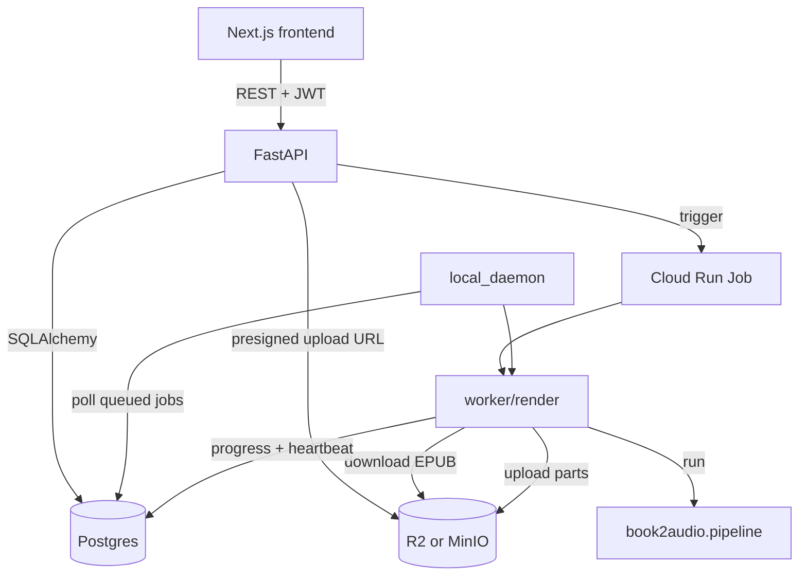

# Chorus

(repo: epub-to-audio-book)

*Turns an EPUB into a multi-voice `.m4b` audiobook with chapters, cover art and metadata, using a local CPU-only TTS model.*


```bash
book2audio generate "mybook.epub"
```

Commercial AI audiobook tools are cloud-only, billed per minute, and take your library to someone else's servers. Chorus (CLI name `book2audio`) runs the [Kokoro](https://github.com/thewh1teagle/kokoro-onnx) model through ONNX Runtime on CPU, so the render path needs no PyTorch, no GPU and no API key.

The narrator gets one voice. Each detected character gets another, assigned once and kept for the whole book. Dialogue is separated from narration, and speakers are attributed from dialogue tags, pronoun resolution and two-speaker alternation, with no manual tagging.

Every stage between the EPUB and the audio works on plain data, so segmentation, attribution and casting are unit-tested without loading a model. The same pipeline runs from the CLI and from a hosted job worker (FastAPI, Postgres, R2, Next.js frontend) through one shared render module.

## Measured performance

CPU only, default settings (multi-voice, music bed on), Intel Core i5-12500H (12 cores / 16 threads), Windows 11:

| Run | Audio | Wall time | Real-time factor |
| --- | --- | --- | --- |
| 1 | 725.4 s | 7:17 | 1.66x |
| 2 | 725.4 s | 6:20 | 1.91x |

Input: chapter 1 of *Alice's Adventures in Wonderland* (Project Gutenberg, public domain), 2,181 words and 11,281 characters. Wall time is the CLI progress timer with the model already loaded, on a machine that was not idle. Audio length is the ffprobe duration of the output file and includes the title, pauses and music tail.

## Features

**Multi-voice casting** — gives each character a stable Kokoro voice, busiest speakers first so leads never share one, gender-matched when pronouns in dialogue tags reveal it (`tts/voices.py`).

**Speaker attribution** — heuristic `Attributor` using dialogue tags, pronoun resolution and two-speaker alternation; nicknames fold into full names (`attribution/heuristic.py`).

**Chapterized `.m4b`** — `ffmpeg` muxes chapter WAVs into AAC with chapter markers, extracted cover art and tags.

**Resumable renders** — per-chapter state lives in the work directory; re-running the same command skips finished chapters and repeats only the interrupted one.

**Progressive output** — writes a playable `<name>-part-NN.m4b` every 10 chapters (`--batch`, `0` for one file), so listening starts before the book finishes.

**Audio production** — per-line loudness normalization, punctuation-driven pacing ("!" faster and louder, "..." slower and softer), a procedurally synthesized ambient music bed mixed relative to speech RMS, and a 1.8 s gap between chapters.

**Hosted mode** — FastAPI service with JWT auth (argon2 password hashes, login rate limiting), job queue in Postgres, EPUB and audio in Cloudflare R2, rendering on a Cloud Run Job or a local polling daemon, and a Next.js frontend.

## How it works




1. **Parse** (`epub/`) reads the spine for reading order, pulls each chapter's heading and paragraphs, extracts the cover and skips front matter.
2. **Segment** (`text/`) splits paragraphs into ordered narration and dialogue runs and marks scene breaks.
3. **Attribute** (`attribution/`) decides who speaks each line behind an `Attributor` interface.
4. **Cast** (`tts/voices.py`) assigns voices from a fixed pool.
5. **Synthesize** (`tts/engine.py`) chunks long text on sentence boundaries, because Kokoro synthesizes a bounded number of tokens per call.
6. **Assemble** (`assemble/`) joins segments with pauses, normalizes loudness, mixes the music bed and muxes with `ffmpeg`.

### Key decisions

- **Local ONNX TTS**: Kokoro on ONNX Runtime over a cloud TTS API, because the render path then needs no keys, has no per-minute cost and never uploads the library. The price is CPU-bound speed (about 1.7-1.9x real time, measured above).
- **Heuristic attribution behind an interface**: dialogue-tag and pronoun rules over an LLM labeller, because they are deterministic, free and unit-testable. The `Attributor` interface leaves room for an LLM strategy.
- **Synthesized music bed**: detuned sine partials and filtered noise generated in code over bundled audio files, so there are no assets or licences to carry. Level is set relative to the narration's own RMS.
- **One shared render module**: `worker/render.py` serves both the Cloud Run entrypoint and the local daemon so the two cannot drift apart.
- **In-process login rate limiter**: a sliding window in `api/auth/rate_limit.py` over an external store. It is per-instance and does not coordinate across API replicas.

## Tech stack

| Technology | Role | Why |
| --- | --- | --- |
| Python 3.12 | CLI, pipeline, API | — |
| kokoro-onnx | Speech synthesis | ONNX Runtime on CPU, no PyTorch or GPU |
| ffmpeg | AAC/M4B muxing, chapter markers | — |
| BeautifulSoup | EPUB XHTML parsing | — |
| FastAPI, SQLAlchemy, Alembic | Hosted API and migrations | — |
| Postgres (psycopg) | Users, refresh tokens, jobs | — |
| Cloudflare R2 (boto3) | EPUB and audio storage | MinIO substitutes in hybrid mode |
| Next.js 16, React 19, Tailwind 4 | Frontend | — |
| pytest | Tests | — |

## Getting started

Requirements: Python 3.12 (managed by [`uv`](https://docs.astral.sh/uv/)) and `ffmpeg` on `PATH`. The Kokoro model files (about 325 MB) download on first run into `%LOCALAPPDATA%\book2audio\models` (`~/.cache` on Unix).

```bash
uv sync

# chapters, detected characters and voice cast, no audio
uv run book2audio generate "epubs/mybook.epub" --dry-run

# whole book to output/mybook.m4b
uv run book2audio generate "epubs/mybook.epub"

# first 3 chapters only
uv run book2audio generate "epubs/mybook.epub" --limit 3
```

### CLI options

```
book2audio generate <epub> [options]

  -o, --out PATH          Output .m4b path (default: ./output/<name>.m4b)
      --work-dir PATH     Scratch dir for chapter audio + resume state
      --narrator VOICE    Narrator voice id (default: am_michael)
      --voice NAME=VOICE  Override a character's voice (repeatable)
      --male-voice VOICE / --female-voice VOICE
      --speed FLOAT       0.5-2.0 (default 1.0)
      --bitrate STR       AAC bitrate (default 64k)
      --limit N           Only render the first N chapters
      --batch N           Playable .m4b every N chapters (default 10; 0 = one file)
      --chapter-gap SEC   Pause between chapters (default 1.8)
      --no-music / --music-volume 0-1 / --music-preset ambient|drone|rain
      --no-expressive     Disable punctuation-driven pacing
      --dry-run           Parse, attribute and cast without synthesizing
      --thumbnails        Validates freellmapi credentials; thumbnail files are
                          produced by the hosted worker, not this CLI
```

Run `--dry-run` first to see detected character names, then pin voices with `--voice NAME=VOICE`. Kokoro voice ids follow `<accent><gender>_<name>`, for example `am_michael` or `bf_emma`; the pool lives in `src/book2audio/tts/voices.py`.

### Hosted mode

```bash
uvicorn book2audio.api.main:app           # API (docker/Dockerfile.api)
python -m book2audio.worker.entrypoint    # Cloud Run Job worker
python -m book2audio.worker.local_daemon  # local polling worker
```

See `DEPLOYMENT.md` for the Neon / Render / Vercel / R2 setup.

## Configuration (hosted mode)

The CLI needs no environment variables. These names are read in `src/`.

| Variable | Used by | Description |
| --- | --- | --- |
| `DATABASE_URL` | API, worker, Alembic | Postgres connection string; raises if unset |
| `JWT_SECRET` | API auth | Token signing secret; raises if unset |
| `CORS_ORIGINS` | API | Allowed frontend origins |
| `R2_BUCKET`, `R2_ACCOUNT_ID`, `R2_ENDPOINT_URL`, `R2_ACCESS_KEY_ID`, `R2_SECRET_ACCESS_KEY` | storage | R2, or MinIO via endpoint URL |
| `CLOUD_RUN_JOB_NAME` | job service | Job triggered per render |
| `JOB_CONFIG`, `WORKER_MODE` | worker entrypoint | Job payload and mode |
| `LOCAL_WORKER_POLL_INTERVAL_SECONDS` | local daemon | Poll interval |
| `CLEANUP_GRACE_PERIOD_DAYS` | cleanup job | Artifact retention |
| `FREELLMAPI_API_KEY`, `FREELLMAPI_BASE_URL`, `FREELLMAPI_IMAGE_MODEL` | thumbnails | Optional chapter images |

## API

`POST /auth/register`, `/auth/login`, `/auth/refresh`, `/auth/logout` — account and token lifecycle.

`POST /jobs/upload-url` — presigned URL for the EPUB upload.

`POST /jobs` — creates a render job. `GET /jobs`, `GET /jobs/{id}`, `DELETE /jobs/{id}` — list, inspect, delete.

`GET /voices` — available voices.

## Testing

```bash
uv run pytest
```

380 tests are collected (`pytest --collect-only -q`). They cover segmentation, attribution, voice casting, normalization, music, EPUB parsing, pipeline batching and callbacks, config, auth and rate limiting, job ownership and the worker entrypoints. Real synthesis is exercised through the `--limit` render path rather than mocked.

## Roadmap

| Status | Item |
| --- | --- |
| Done | CLI pipeline, multi-voice casting, resumable and batched `.m4b` output, music bed, hosted API and worker |
| Planned | LLM attribution and casting by personality, age and role, behind the existing `Attributor` interface |
| Planned | Word-level emphasis, which needs a TTS backend with SSML/prosody control; Kokoro takes plain text only |
| Planned | Chapter images, pending a local-vs-cloud decision on GPU, latency and cost |
| Planned | Library, player and voice-preview GUI |

## License

**Source-available, not open source.** Chorus (book2audio) is published under the
[PolyForm Strict License 1.0.0](LICENSE) so you can read the code, run it, and learn
from it for personal, research, or evaluation use.

You may **not** use it commercially, redistribute it, rebrand it, or publish modified
versions without written permission. Copyright (c) 2026 Yassine Krichen. All rights
not granted by the license are reserved.

For commercial licensing or collaboration: krichenyassine22@gmail.com
