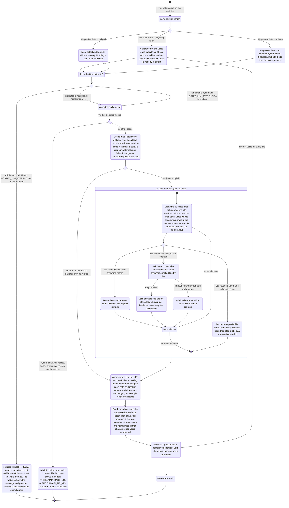
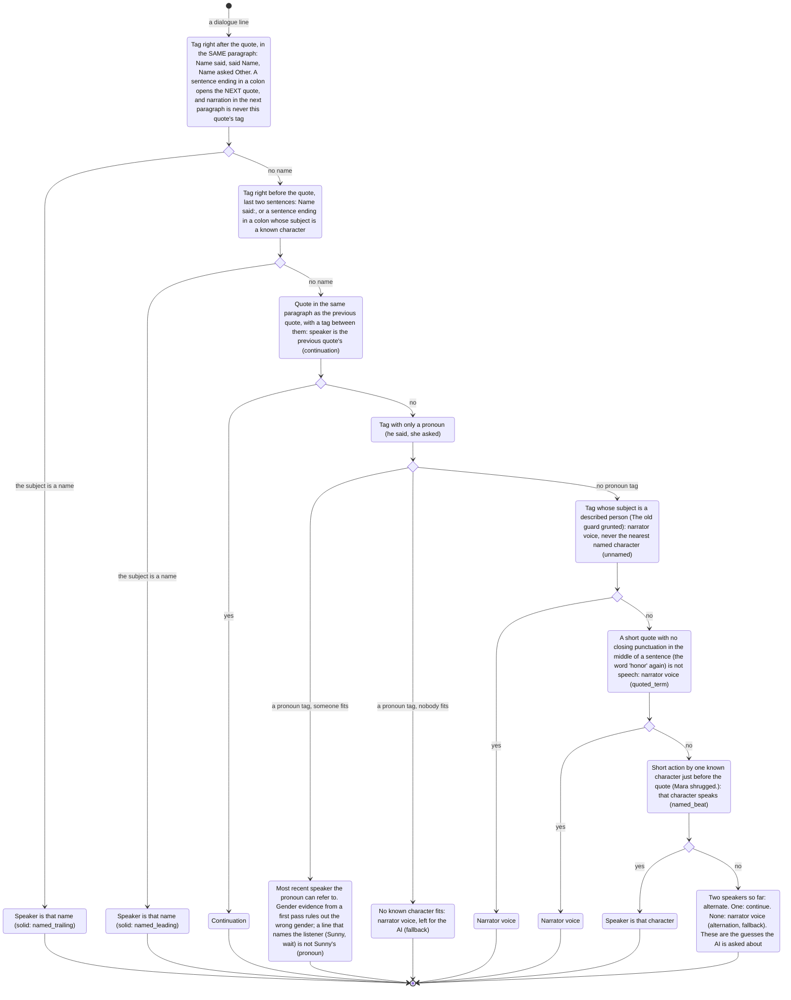

# AI speaker detection: who is speaking

Before: the app worked out who speaks each line of dialogue with offline rules only. The
rules are right when the text names the speaker ("said Sunny"). When it does not, they
guess from pronouns, from who spoke last, or from the nearest name, and the guess is often
the wrong character. A wrong speaker means a wrong voice.

Now there is an optional "AI speaker detection" switch. When it is on, the offline rules
still run first. Then an AI model is asked only about the lines the rules had to guess.
Lines where the text names the speaker are left alone and cost nothing. If the AI is
unavailable or fails, the offline answer is kept and the book still renders. This page
shows the whole flow.

## The flow

## How the offline rules pick a speaker

These rules run first in every mode (they are the whole job when AI detection is off). Each
dialogue line goes through the checks in order and stops at the first one that answers. The
name that is the *subject* of the speech verb is the speaker: in "Nephis asked Sunny" the
second name is who was asked.

Genders are read from the narration, not from who was assigned a line, so the rules run
twice: the first pass finds the characters and their gender evidence, the second uses it
to decide who "he" or "she" can be.

## What changes for you

- The voice casting tab has a new switch, "AI speaker detection". It is off by default.
- When it is on, the guessed lines are checked by an AI model. The usual effect is that
  more lines should go to the right character, and so to the right voice (not measured yet,
  see the limits below).
- It is slower, because each window is a request to the model.
- If you turn on "Narrator reads everything", the AI switch disappears and is set back
  to off. That job never asks the AI anything.
- If the server does not allow AI detection, you see "AI speaker detection isn't available
  on this server yet. Turn off "AI speaker detection" and try again." and no job is
  created. Turn the switch off and submit again.

## Defaults

- AI speaker detection is off (`attributor` is `heuristic`). On means `hybrid`.
- At most 150 requests per book. When they run out, the remaining windows keep the offline
  labels. A window that had to try a second model still counts once.
- The AI is a list of models, not one (see [llm-model-chain.md](llm-model-chain.md)). A
  rate-limited model is skipped and the next one answers.
- 3 failed requests in a row stop the AI for the rest of the book. "Failed" means every
  model in the list failed that window, not one model hitting its limit.
- The AI only decides lines that were guesses. A name written in the text always wins.

## What happens when the AI fails

The code never fails a render because of the AI (`LLMAttributor.attribute` in
`src/book2audio/attribution/llm.py`):

- One model fails (limit reached, timeout, network error, bad reply shape): the next model
  in the list gets the same window. Only when every model fails does that window keep its
  offline labels, and the run goes on.
- A reply with some missing or invalid lines: those lines keep their offline label, the
  valid ones are used.
- 3 failures in a row: the AI is not asked again for this book. The rest keep their
  offline labels and a warning is recorded.
- Request budget used up: the same, with a different warning.
- An unexpected error inside the AI step: caught, counted as a failed window, a warning
  is recorded, the offline labels stay.

The one hard failure is missing credentials. The worker checks them before doing any work
and stops the job with an error if `FREELLMAPI_BASE_URL` or `FREELLMAPI_API_KEY` is
missing. This check is skipped for narrator only jobs.

## What you must set up

On Render (the API):

- `HOSTED_LLM_ATTRIBUTION=enabled`, exactly this value, then redeploy. Unset means every
  AI job is refused with HTTP 403. Narrator only jobs skip this check. Any other value (for example `true` or `Enabled`) makes
  the API refuse to start. Registration is open and each AI job spends the freellmapi key,
  so this switch is deliberately closed by default.

On the machine that runs the worker (the local worker's `.env`):

- `FREELLMAPI_BASE_URL`, including `/v1`.
- `FREELLMAPI_API_KEY`.
- Optional: `FREELLMAPI_MODEL_ATTRIBUTION` (or `FREELLMAPI_MODEL`), a comma-separated list
  of model names tried in order, so one model's daily limit does not stop a book. If both
  are unset the built-in list is used (`gemini-2.5-flash-lite`, `gpt-oss-120b`,
  `llama-4-scout`). The local `.env` sets `FREELLMAPI_MODEL_ATTRIBUTION` to that list. See
  [llm-model-chain.md](llm-model-chain.md).

Restart the worker after changing `.env`. Do not put these values in the frontend or in
Vercel: only the worker talks to the AI gateway.

## How to try it

1. Set the two required worker variables above and `HOSTED_LLM_ATTRIBUTION=enabled` on Render.
2. On the website, upload a book, open Voice Casting and turn on "AI speaker detection".
3. Create the job. Without step 1 on Render you get the 403 message instead.

From the command line: `uv run book2audio generate "epubs/mybook.epub" --limit 10
--attributor hybrid`. Add `--dry-run` to see how many AI requests it would make without
sending any. The command line ignores `HOSTED_LLM_ATTRIBUTION`.

## Honest limits

- On the 80-line speaker spot check (Shadow Slave book 1) the offline rules get 33 right
  and the AI mode with the default model list gets 61. That is one run of 80 lines, an
  estimate. Details in [llm-model-chain.md](llm-model-chain.md).
- The AI can be wrong too. It only replaces guesses, never a name found in the text.
- Book text for guessed lines is sent to the freellmapi gateway.
- The AI step does not decide gender. Gender still comes from the text evidence, and an
  unsure character is read by the narrator. An AI gender check is a possible next step.
