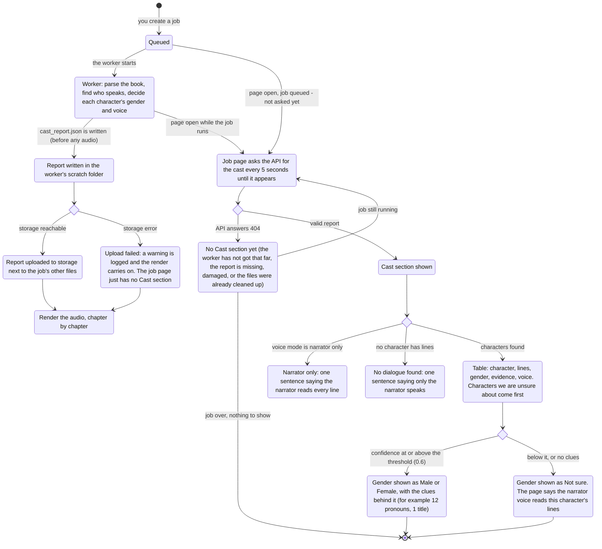

# Cast on the job page: see who speaks before you listen

Before: the cast report (who speaks, their gender, the voice they get) was only printed in
the command line, and a hosted worker kept `cast_report.json` in its scratch folder. On
the website you could not see it at all.

Now the worker uploads the report next to the job's other files, the API serves it to the
job's owner, and the job page shows a **Cast** section: each character, how many lines
they speak, their gender, why we think so, and the voice that reads them. This page shows
the whole flow.

## The flow

## What changes for you

- The job page has a **Cast** section as soon as the worker has decided the cast, usually
  before the first chapter is done.
- A character shown as **Not sure** is read by the narrator voice. The page says so in plain
  words, so you know why a character sounds like the narrator.
- Only the owner of a job can fetch its cast report. Someone else's job answers "not found",
  the same as a job that does not exist.
- The API sends only these fields: name, lines, gender, confidence, voice, voice source, a
  sample line, the clue counts, and up to three clue sentences. Internal numbers stay in the
  stored file.

## Defaults

- The Cast section appears by default for every hosted job. There is nothing to switch on.
- The threshold for "sure enough" is the same 0.6 the command line uses.

## How to try it

1. Start the API and a worker (local worker or Cloud Run), and the frontend.
2. Create a job in the wizard with "Narrator reads everything" off.
3. Open the job page. After a short wait the **Cast** section appears above **Chapters**.
4. Try the narrator-only switch on another job: the section is one sentence.

API: `GET /jobs/{job_id}/cast` (bearer token). It answers 404 when there is no report to show.

## Honest limits

- The report covers the chapters the job renders, not the whole book.
- This section only shows the cast. Fixing a character comes next: the gender override in the
  wizard, and the review step before rendering.
- If the report upload fails, the section is missing for that job; the audio is not affected.
- A job whose files were cleaned up (failed or canceled jobs, after a grace period) no longer
  has a Cast section.
