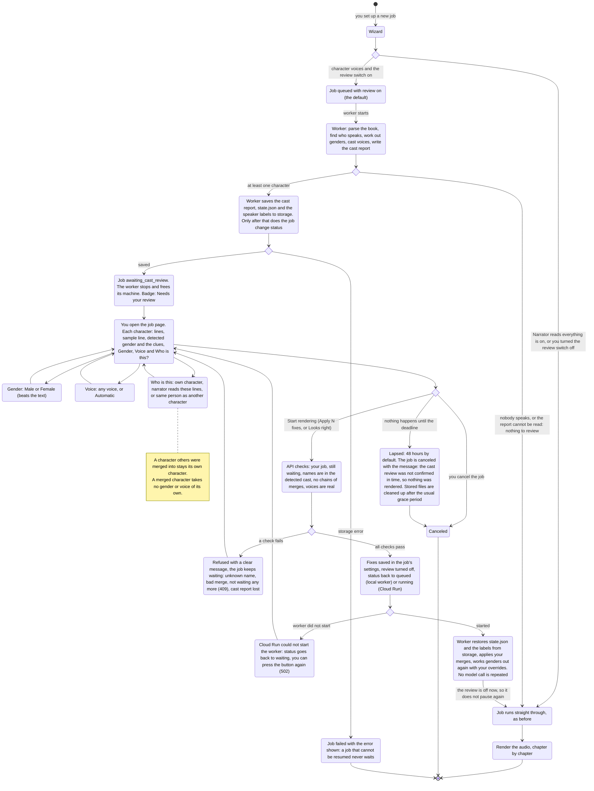

# Cast review: check who speaks before any audio is made

Before: a hosted job went straight from "find the characters" to "make hours of audio".
If the app mixed up two names, or gave a woman a man's voice, you only found out by
listening, and fixing it meant making the whole job again.

Now a job pauses once the cast is known. The job page shows each character with the
detected gender and voice. You can fix the gender, pick a voice, say that two names are the
same person, or hand a character to the narrator. Then you press **Start rendering**. The
pause costs nothing while you think: no worker keeps running, and the model is not asked
again when the job resumes. This page shows the whole flow.

## The flow

## What changes for you

- A new status, **Needs your review**, and a review card at the top of the job page. Chapters
  and parts appear once rendering starts.
- On the card, for each character: how many lines, a sample line, the detected gender with
  the clues, and three controls: **Gender**, **Voice** and **Who is this?**.
  **Who is this?** is where you merge a name into another character ("Same person as
  Nephis") or send a character to the narrator.
- Characters the app is unsure about come first, as in the cast report.
- The button says **Apply N fixes and start rendering**, or **Looks right, start rendering**
  when you changed nothing.
- The card shows the deadline. If you never confirm, the job is canceled and the page says so.
- You can still cancel the job while it waits.

## Defaults

- Review is **on** for character voices and **off** for "Narrator reads everything" (there is
  no cast to check).
- A cast with nobody to review does not pause.
- The wizard has a switch, **Check the cast before rendering**, to turn it off.
- A review that is never confirmed is canceled after **48 hours**. The operator can change it
  with `CAST_REVIEW_TIMEOUT_HOURS` (1 to 720). Canceled jobs have their stored files cleaned up
  after the usual grace period (7 days).
- The command line never pauses. `--dry-run` already shows the cast.

## How to try it

1. Run the API, a worker and the frontend (see `DEPLOYMENT.md`).
2. Apply the migration: `alembic upgrade head` (adds `jobs.cast_review_requested_at`).
3. New job, upload a book, leave **Check the cast before rendering** on.
4. Wait for the badge **Needs your review**, open the job, change a character, press
   **Start rendering**.
5. To see the expiry, start the API with `CAST_REVIEW_TIMEOUT_HOURS=1` and leave a job waiting.

API: `POST /jobs/{id}/cast-review` with `{"characters": [{"name": "Rain", "merge_into": "Sunny"}]}`.
Each entry holds a `gender` (`m` or `f`) and/or a `voice`, or `merge_into`, or
`read_by_narrator: true`. An empty list confirms the cast as it is.

Rollback: `alembic downgrade 0004`. Jobs waiting for review at that moment are marked failed
first, because the older code does not know the status.

## Limits and races

- The review lists at most 100 characters (the busiest, characters we are unsure about
  first) and only names up to 80 characters. Others keep their voice but cannot be edited,
  and the card says how many are not listed. Only the copy uploaded for the website is
  trimmed; the worker's own `cast_report.json` (and the command line's) keeps every
  character. The upload, the API and the card use the same limits, so a large cast can never
  produce a card that the server refuses.
- A job can hold 100 gender fixes and 100 voice choices. If the wizard already set some, the
  card tells you before you press the button when the review would go over.
- Cancel, confirm, worker success, worker failure, the pause and the expiry are all
  conditional database updates, so none of them can overwrite another's result. A cancel
  that lands just after a confirmation also stops the worker the confirmation started.
- If the worker cannot be started after you confirm, the job goes back to waiting with its
  earlier settings, not the ones you just sent.
- The cleanup job also cancels reviews that ran out of time even if nobody opened the job
  again, so their stored files are cleaned up after the grace period.
- A job waiting for review whose cast report has gone shows an error and a Cancel button, not
  an endless placeholder.

## Honest limits

- A merge is permanent for this job. To undo it, create the job again.
- A merge only fixes lines the app gave to the wrong name. It does not find lines it gave to
  nobody.
- "Same person as" lists characters in this cast only. There is no free-text rename.
- Sending a character to the narrator removes it from the cast report of the resumed run.
- The wait can be short or long, but while it lasts the job holds no worker. What it holds is
  stored files (the report, `state.json` and the speaker labels), kept until the job finishes
  or is cleaned up.
- If the cast report is lost while a job waits (for example, files cleaned up by hand), the
  review answers with a message asking you to create the job again.
