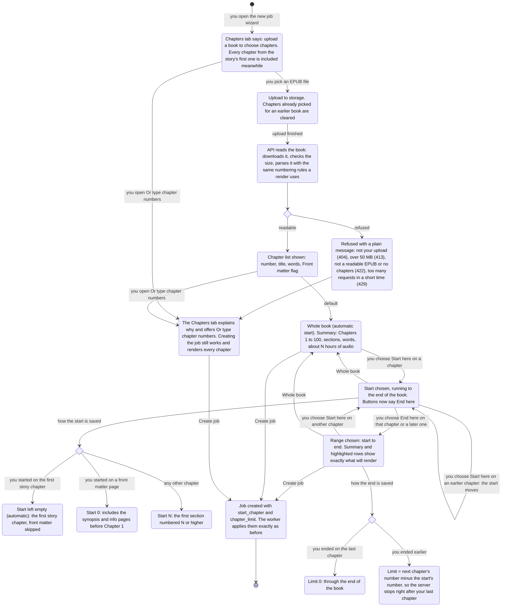

# Chapter picker: choose chapters from the book's own list

Before: to render only part of a book on the website you typed two numbers ("start at
chapter" and "chapter limit") without seeing the book's chapters. If you did not know that
the first page is a synopsis, or that the book numbers its chapters from 1, you guessed.

Now, once the book has uploaded, the wizard has a **Chapters** tab. It lists every section
of the book with its number, title, word count and a **Front matter** flag, and you pick a
range by clicking: **Start here** on the first chapter, **End here** on the last one. The
picker writes the same two settings as before (`start_chapter` and `chapter_limit`), so
nothing changes for the server or for jobs made without it. This page shows the flow.

## The flow

## What changes for you

- A **Chapters** tab in the new job wizard, between Voice Casting and Audio Production.
- The list shows the book's own chapter numbers ("Chapter 7" is 7), the title, the word count,
  and marks synopsis and info pages as **Front matter** (skipped unless you start on one).
- A summary line above the list says what you picked, for example "Chapters 1 to 10 · 10
  of 612 sections · 48,210 words · about 5 h 20 min of audio". The hours use a calm pace of
  150 words a minute at your chosen speed.
- **Whole book** puts the selection back to the default in one click.
- **Preview mode** (first 3 chapters), the numeric "Start at chapter" and "Chapter limit"
  boxes moved here from Audio Production. The boxes sit under **Or type chapter numbers**
  and stay in step with the list.
- A chapter that the book splits into several sections is picked whole, at both ends.

## Defaults

- No range picked means start automatically at the story's first chapter and go to the end
  (`start_chapter` empty, `chapter_limit` 0), the same as before.
- Picking a new book clears any range picked for the old one.

## How to try it

1. New job, upload an EPUB (try the first Shadow Slave book).
2. Open the **Chapters** tab. The list appears after a moment, with SYNOPSIS marked
   **Front matter** and Chapter 1 first in the selection.
3. Choose **Start here** on Chapter 5, then **End here** on Chapter 8. The summary reads
   "Chapters 5 to 8".
4. Create the job. The job page shows four chapters.

API: `POST /jobs/inspect` with `{"epub_object_key": "uploads/<your id>/..."}` returns
`{title, author, chapters: [{index, number, title, front_matter, word_count}]}`.

## Honest limits

- The book is untrusted input read inside the API process. The download is capped at 50 MB
  while streaming and pinned to one version of the file; the archive is refused before parsing
  if it has too many entries, an entry over 16 MiB, more than 100 MB unpacked, or a forged
  size; any other parser failure is a plain 422. The parser is not run in a separate process
  with a memory limit (there is no portable way to do that on both Windows and Linux), so these
  caps and the rate limit are the protection. Only the user's own uploads can be read, and the
  same ownership check now guards job creation.
- The server reads the book once to build the list, so a large book takes a few seconds.
  Reading is limited to 20 books per user every 10 minutes (`INSPECT_RATE_LIMIT_PER_USER`,
  `INSPECT_RATE_LIMIT_WINDOW_SECONDS`).
- A kept prologue cannot be picked alone: it does not use up the limit, so ending on it also
  includes Chapter 1. The summary shows what will really render.
- Starting on a front matter page means starting at the very first page, because the server's
  "include front matter" setting is all or nothing.
- The picker's counting is a copy of the server's rule (`Config.selection_bounds`). They are
  kept in step by tests on both sides, but a change to one needs a change to the other.
- The list follows the file's own reading order and titles. A book that does not number its
  chapters is counted by position, as everywhere else.
