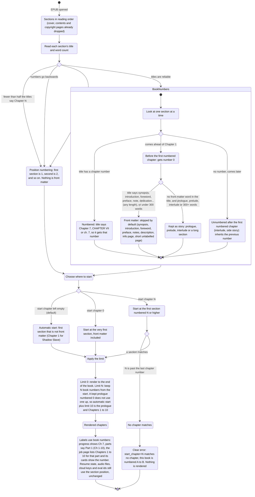

# Chapter selection and numbering

Today a book is cut into "sections" in the order they appear in the EPUB, and the old
"start at chapter N" counted those sections. The Shadow Slave file has a SYNOPSIS page
before Chapter 1, so "the first 10 chapters" gave the synopsis plus Chapters 1 to 9.

Now every section gets the chapter number the book itself uses, and "start" and "limit"
count those numbers. This page shows the whole flow.

## The flow



## What changes for you

- The chapter number you type (or see) is the number in the book's title: "Chapter 7" is 7.
- The Shadow Slave synopsis page is now number 0 and is skipped by default. It is not
  deleted: `--start-chapter 0` brings it back.
- A real prologue (or prelude, interlude, or any long unlabelled section) before Chapter 1
  also gets 0 but is kept, so no story content is dropped. It does not use up the limit:
  with a prologue, the defaults plus `--limit 10` give the prologue and Chapters 1 to 10.
- A page before Chapter 1 whose title says synopsis, summary, blurb, description,
  information, introduction, foreword, preface, author's note, translator's note,
  dedication, acknowledgements, copyright or contents is front matter whatever its
  length. The 300-word rule only applies to pages with none of those words in the title,
  and a title saying prologue, prelude or interlude is never treated as short front matter.
- Sections without a number that come after Chapter 1 (an interlude between chapters)
  share the number of the chapter before them, so they stay inside the range.
- Books that do not number their chapters (or number them oddly, like the Penrod sample)
  behave as before: sections are counted by position, nothing is skipped.
- In the website form, "Start at chapter" can be left empty. Empty means automatic; 0
  includes the synopsis and info pages.
- Chapter cards on the job page show the book number when the job has one. Jobs created
  before this change still load and look the same as before.

## Defaults

| Setting | Default | Meaning |
|---|---|---|
| start chapter | empty (automatic) | first chapter that is not front matter |
| limit | 0 | through the end of the book |
| limit with a start | N | N book numbers counted from the start, so default start plus limit 10 is Chapters 1 to 10 |

Jobs saved before this change still load:

- A hosted job saved with `start_chapter = 1` now starts at Chapter 1 and skips front
  matter (before, it counted sections, so it started at the first section).
- A job saved with `start_chapter` above 1 now means that book chapter number. On the job
  page its chapter cards are numbered 1 to N for the chapters in the selection.
- Chapters and parts rendered before this change have no book number stored, so the job
  page falls back to showing their position numbers.

## How to try it

Dry run, no audio and no model download. `--work-dir` keeps the scratch files out of
`output/`:

```
.venv\Scripts\python.exe -m book2audio.cli generate "epubs/Guiltythree - Shadow Slave 001-100 (2022) - libgen.li.epub" --limit 10 --dry-run --work-dir "%TEMP%\chapter-selection-check"
```

Expected: a table whose first row is `0  SYNOPSIS  front matter yes  selected (blank)`, then
Chapters 1 to 10 marked selected, and `... and 90 more section(s) after the selection`.

Other things to try:

- `--start-chapter 0 --limit 10` adds the synopsis, so you get the synopsis plus Chapters 1 to 9 (front matter counts toward the limit; a prologue does not).
- `--start-chapter 5 --limit 3` gives Chapters 5, 6 and 7.
- `--start-chapter 500` prints the full table and a clear error naming the numbers this
  book has (0 to 100).
