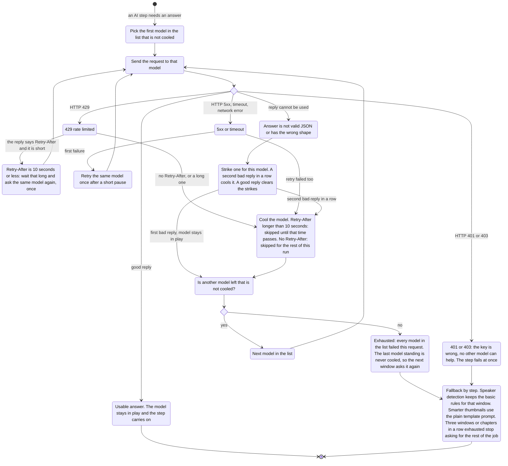

# AI model chain: a run no longer dies when one model hits its limit

Before: every AI step (speaker detection, smarter thumbnails) used one model, set by
`FREELLMAPI_MODEL`, and `auto` if it was missing. The free model people pinned,
gemini-3.1-flash-lite-preview, only allows 20 requests a day, so a book stopped with
"429 too many requests" after about 20 requests. The job still finished, but the rest of
the book fell back to the basic rules and the voices got worse.

Now each AI step has an ordered list of models. If one model is rate limited, down, too
slow or sends back nonsense, the next one gets the request. The job only falls back to the
basic rules when every model in the list has failed. This page shows the whole flow.

## The flow

## What changed for the user

- Model settings take a list. `FREELLMAPI_MODEL=a,b,c` is tried in that order. A single
  name still works exactly as before.
- Two optional per-step settings: `FREELLMAPI_MODEL_ATTRIBUTION` (speaker detection, needs a
  capable model) and `FREELLMAPI_MODEL_LIGHT` (scene briefs and other short jobs, cheap
  models are enough). A per-step setting beats `FREELLMAPI_MODEL`, which beats the built-in
  list.
- A model that hits its limit is skipped for the rest of that run (or until its
  Retry-After time, when the gateway sends one) and a warning is logged. Nothing in the
  website or the job page changes.
- The job's request budget still counts one per window, not one per HTTP request, so a
  window that tries two models uses one unit of budget. The run summary also prints the
  real number of HTTP requests and how many were rate limited.
- A model that times out or answers 5xx without a Retry-After rests for two minutes, not
  the whole run. A 429 without Retry-After (a daily cap) and an unknown model (404) rest
  for the whole run. A 400, 413 or 422 (content filter, prompt too large) is held against
  the request, not the model: it takes a strike and is cooled only after two in a row.
  Only a 401 stops the call at once; a 403 moves on to the next model.
- **One-time cache reset.** This release changes what the attribution and scene-brief
  caches are keyed on, so the first resume of an existing job asks the models again for
  every window once. After that the caches work as before.
- One `LLMClient` is one run and is not thread-safe: give each thread its own.

## Defaults (when nothing is set)

Chosen from a measured run, see "How they were chosen" below.

| Step | Order |
| --- | --- |
| Speaker detection (attribution) | `gemini-2.5-flash-lite`, `gpt-oss-120b`, `llama-4-scout` |
| Light jobs (scene brief) | `gemini-2.5-flash-lite`, `gpt-oss-20b`, `gpt-oss-120b` |

The owner's local `.env` sets both per-step variables to the same values. Models the
gateway does not have are skipped like any other failure, so these defaults are safe on a
gateway with a different catalog, just slower to settle.

## Cache and resuming

The speaker-detection cache and the scene-brief cache are keyed by what was sent (prompt
text, sampling settings), not by which model answered. Which model of the chain answered
a window depends on which ones were rate limited at that moment, so keying on it would
make a resumed run ask for everything again, which is exactly the situation the chain is
for. Resuming a book after a daily limit therefore reuses every answer already stored. The
cost: if you switch to a better model later, delete `attribution-cache.json` (and
`scene_briefs.json`) in the job's work folder to re-ask. Old cache entries written before
this change do not match any more, so a book that was partly done is asked again once.
Chapters whose thumbnail was already drawn at the smarter level are drawn once more for
the same reason.

## How they were chosen

The 80-line speaker spot check (80 labelled lines from chapters 1 to 10 and 36 to 43 of
Shadow Slave book 1, hybrid mode, one pinned model per run, same prompt, 38 windows per
run). Higher is better. The offline rules alone score 33/80.

| Model | Correct of 80 | Wrong-gender voice lines (of 73) | Windows failed (of 38) | HTTP 429 |
| --- | --- | --- | --- | --- |
| gpt-oss-120b | 61 | 7 | 0 | 0 |
| gemini-2.5-flash-lite | 60 | 7 | 3 (gateway 404 "model not found") | 0 |
| llama-4-scout | 59 | 7 | 0 | 0 |
| gemini-2.5-flash | 57 | 8 | 8 (invalid JSON, gateway 404) | 0 |
| gpt-oss-20b | 55 | 8 | 3 (invalid JSON) | 0 |
| gemini-3.5-flash | 33 | 18 | 8, then the breaker stopped it | 7 |
| The chosen chain: flash-lite, then gpt-oss-120b, then llama-4-scout | 61 | 6 | 0 | 0 |

Not measured because the gateway had no usable key for them at the time:
llama-3.3-70b, mistral-small-4, mistral-large-3, nemotron-3-super-120b, deepseek-v4-flash
(all answered 503 "no usable provider key").

The first three models are within one line of each other, so accuracy does not decide
between them. What decides is daily budget and speed: gemini-2.5-flash-lite is the fastest
(about 1 s a window against 4 s) and has a 1000 requests a day free tier; gpt-oss-120b
has the best accuracy, no failed windows and a 1000 requests a day tier, so it comes
second; llama-4-scout is a third fallback with similar accuracy and no failed windows
(its daily limit is not known). The windows that failed above are what the chain exists
for: the chain run had none.

The light chain is ordered by cost. One real scene-brief request per model on chapters 3 and
40: every candidate returned a usable brief, but llama-4-scout and ministral-3-8b put
Nephis into chapter 3, where she does not appear, so they were left out.

The numbers measure speaker lines, not the whole book. Fifteen of the 80 lines are in the
"named trailing" group. The model is never asked about them (the offline rules keep their
answer) and 10 of them are wrong for every model, which caps all scores at about the same
level. One run of 80 lines is an estimate, not a benchmark.

## How to try it

- Nothing to do: the defaults apply. To see it work, run
  `uv run book2audio generate "epubs/mybook.epub" --limit 10 --attributor hybrid` and
  look for "cooled" warnings in the log if a model is limited.
- To pin your own order, put `FREELLMAPI_MODEL_ATTRIBUTION=modelA,modelB` in `.env` and
  restart the worker.
- To go back to one model, set `FREELLMAPI_MODEL=modelA` and remove the two per-step
  lines.
- The evaluation scripts need one pinned model (a list would make the result depend on
  which model was free): `FREELLMAPI_MODEL=modelA python evals/attribution/run_eval.py
  --split test`.
