# One file per chapter, named after the chapter

Before: audio came out in parts of 10 chapters ("Part 1", "Part 2"). Asking for one file
per chapter still gave "Part 1", "Part 2" names, and the chapter title only lived inside
the file's metadata.

Now you can ask for one file per chapter and each file is named like
`001 - Nightmare Begins.m4b`. Chapter titles come from the EPUB, which is untrusted text,
so every name is cleaned before it is used. This page shows the whole flow.

## The flow

```mermaid
stateDiagram-v2
    [*] --> Choice: you start a render (command line or website)
    state "What do you want?" as Choice
    state wantsChapters <<choice>>
    Choice --> wantsChapters

    state "Parts of several chapters (batch size 10 by default, or any N above 1)" as Parts
    state "One file per chapter (batch size 1)" as PerChapter
    state "One file for the whole book (batch size 0)" as WholeBook
    wantsChapters --> Parts: default
    wantsChapters --> PerChapter: switch on One file per chapter, or --batch 1
    wantsChapters --> WholeBook: batch size 0

    state "Pick a name pattern (template)" as Resolve
    state hasTemplate <<choice>>
    Parts --> Resolve
    PerChapter --> Resolve
    WholeBook --> Resolve
    Resolve --> hasTemplate

    state "Use your pattern" as OwnPattern
    state "Default pattern: chapter number padded to 3 digits, dash, chapter title" as ChapterDefault
    state "Website default pattern: book title, dash, Part and number" as PartDefault
    state "Command line, no pattern: keep the old names (book.m4b, or book-part-01.m4b and so on)" as LegacyNames
    hasTemplate --> OwnPattern: you typed a pattern
    hasTemplate --> ChapterDefault: no pattern and one file per chapter
    hasTemplate --> PartDefault: no pattern, website, parts or whole book
    hasTemplate --> LegacyNames: no pattern, command line, parts or whole book

    state checkRule <<choice>>
    OwnPattern --> checkRule
    state "Rejected before anything renders: the chapter title placeholder needs one file per chapter, or the pattern has an unknown placeholder or unsafe characters" as Rejected
    checkRule --> Rejected: chapter title placeholder but not one file per chapter, or bad pattern
    Rejected --> [*]: a clear error message is shown, nothing is rendered
    state "Pattern accepted" as Accepted
    checkRule --> Accepted: pattern is valid
    ChapterDefault --> Accepted
    PartDefault --> Accepted

    state "Name every file, all at once, before anything is written" as Naming {
        [*] --> Number
        state "Chapter number: the book's own number of the file's first chapter (from the part's first number; older jobs fall back to the chapter's position)" as Number
        state "Chapter title: remove a leading Chapter 12 colon or dash, because the number is already in the name" as Prefix
        state "Clean the title: drop invisible and direction-changing characters, replace the characters Windows does not allow with an underscore, squeeze spaces, trim trailing dots and spaces" as Clean
        state "Cap the title at 80 characters, cutting at a whole word" as Cap
        state emptyTitle <<choice>>
        state "Title is empty after cleaning: use Chapter and its number" as Fallback
        state "Whole name capped at 150 characters" as Stem
        state reservedCheck <<choice>>
        state "Windows reserved names (CON, PRN, AUX, NUL, COM1 to 9, LPT1 to 9) get an underscore in front" as Reserved
        state dupCheck <<choice>>
        state "Same name as an earlier file, ignoring upper and lower case: add (2), (3) and so on" as Dedupe
        state "Final file name" as FinalName
        Number --> Prefix
        Prefix --> Clean
        Clean --> Cap
        Cap --> emptyTitle
        emptyTitle --> Fallback: nothing left
        emptyTitle --> Stem: has text
        Fallback --> Stem
        Stem --> reservedCheck
        reservedCheck --> Reserved: reserved name
        reservedCheck --> dupCheck: fine
        Reserved --> dupCheck
        dupCheck --> Dedupe: already used
        dupCheck --> FinalName: unique
        Dedupe --> FinalName
        FinalName --> [*]
    }
    Accepted --> Naming

    state whereUsed <<choice>>
    Naming --> whereUsed
    LegacyNames --> whereUsed
    state "On your computer (command line): the file is written next to the output path" as LocalFile
    state "On the website: the file you download is named this way" as HostedName
    whereUsed --> LocalFile: command line or local worker scratch copy
    whereUsed --> HostedName: website download

    state existsCheck <<choice>>
    LocalFile --> existsCheck
    state "Same work folder resumed: the file keeps the name this run chose. Untouched chapters rebuild nothing, a changed chapter is rebuilt into that same file" as Resume
    state "A file with that name already exists from another run: this run's file becomes name (2), the old one is never overwritten" as NoOverwrite
    state "Written under its name" as Written
    existsCheck --> Resume: this run made it earlier
    existsCheck --> NoOverwrite: another run made it
    existsCheck --> Written: free name
    Resume --> [*]
    NoOverwrite --> [*]
    Written --> [*]

    state "The storage key stays part-01.m4b, part-02.m4b and so on. Only the download name changes, and it is checked again for header safety" as Storage
    HostedName --> Storage
    state storedTemplate <<choice>>
    Storage --> storedTemplate
    state "Old job whose saved pattern no longer renders: the download keeps its storage name, no custom name, page still loads" as LegacyFallback
    storedTemplate --> LegacyFallback: saved pattern now invalid
    storedTemplate --> [*]: saved pattern renders
    LegacyFallback --> [*]
```



## What changes for you

- New switch on the website, Output & Naming tab: **One file per chapter**. On means one
  audio file per chapter, named after the chapter, with a preview such as
  `001 - Nightmare Begins.m4b`. Off goes back to parts of 10 chapters with the old
  `Book - Part 01` style names. If you wrote your own name pattern, switching keeps it
  (unless it uses the chapter title, which only works with one file per chapter).
- New name placeholders: the chapter number, the same padded to N digits, and the chapter
  title. The chapter number is the book's own number (Chapter 1 is 1, a synopsis before it
  is 0), and for a file holding several chapters it is the first chapter's number.
- Hard cleaning of chapter titles: invisible and direction-changing characters are removed,
  Windows-illegal characters become an underscore, titles are cut at 80 characters on a
  word boundary, an empty title becomes "Chapter N", Windows reserved names get an
  underscore in front, and two files with the same name get " (2)", " (3)".
- The batch size help text now says what the code does: 1 is one file per chapter, 0 is a
  single file for the whole book. The website used to refuse 0 while its own help text
  promised it; it accepts 0 now.
- Command line: with `--batch 1` and no pattern, files are named like the website. With
  any other batch size and no pattern, local file names are exactly what they were (resuming
  an existing output does not change names).
- A command-line run with `--batch 1` that you started before this change used names like
  `book-part-01.m4b`. Running it again now switches to the new chapter names. The old files
  are left where they are (nothing is deleted or renamed), so you will have both sets.
- Resuming a run in the same work folder keeps the names that run already chose. If a
  chapter changed, only that chapter's file is rebuilt, into the same file name. A file
  with the same name from a different run is never overwritten; the new file gets " (2)".
- Very long titles (including emoji or non-Latin scripts) are cut so the file name stays
  under 200 bytes before the extension, which keeps it valid on Windows, macOS and Linux.
- Hosted jobs: the storage key stays `part-NN.m4b`; only the download name changes. The
  hosted worker also keeps its own internal `part-NN` file names, so chapter titles never
  become file names on the server.

## Defaults

| Setting | Default |
|---|---|
| Website, One file per chapter | off, batch size 10, name `Book - Part 01` |
| One file per chapter, no pattern | `{chapter:03d} - {chapter_title}`, no book title in the name |
| Command line, `--batch 1`, no pattern | same as above |
| Command line, any other batch size, no pattern | old names: `book.m4b` or `book-part-NN.m4b` |
| Placeholders | `{title}` `{part}` `{part:0Nd}` `{chapter}` `{chapter:0Nd}` `{chapter_title}`; N is at most 10 |
| Pattern length | at most 200 characters |
| `{chapter_title}` | only with batch size 1; otherwise the job or command is rejected with a clear message |

## How to try it

Dry run, no audio and no model download. It prints the file names a real run would plan. It does not look at what is already on disk, so a real run may add " (2)" to a name that is taken:

```
.venv\Scripts\python.exe -m book2audio.cli generate "epubs/Guiltythree - Shadow Slave 001-100 (2022) - libgen.li.epub" --limit 10 --batch 1 --dry-run --work-dir "%TEMP%\per-chapter-files-check"
```

Expected: an "Output files" list starting `001 - Nightmare Begins.m4b`,
`002 - Slave Caravan.m4b`, `003 - The Strings of Fate.m4b`, and ending
`010 - First Man Down.m4b`.

Other things to try:

- Add `--filename-template "Shadow Slave - {chapter:03d} - {chapter_title}"` to put the book
  title back in.
- Leave out `--batch 1` and use `--filename-template "{chapter_title}"`: it is rejected, with
  a message that this placeholder needs one file per chapter.
- Website: open a new job, go to Output & Naming, flip the switch and watch the preview
  change to `001 - Nightmare Begins.m4b`.
