# Chapter thumbnails: the template prompt (Level 1)

Before: when you switched thumbnails on, the picture prompt used the book's title as stored in
the file ("Shadow Slave 001-100") and the full chapter heading ("Chapter 1: Nightmare
Begins"). The image model often painted that title straight onto the picture as big,
garbled lettering.

Now the prompt is a fixed, tested template with the cleaned book title ("Shadow Slave"),
the chapter number, the chapter title without its "Chapter N:" prefix, and a short
excerpt. It spells out "no text, no letters, no words, no watermark, no logo, no
signature, no UI, no border, no frame" because the image service has no separate
"negative prompt" field. No language model is called to write it.

## The flow

```mermaid
stateDiagram-v2
    [*] --> Setting: a render starts
    state "Thumbnails setting" as Setting
    state enabled <<choice>>
    Setting --> enabled
    state "Off (the default): no picture is requested, nothing about the render changes" as Off
    enabled --> Off: thumbnails off
    Off --> [*]
    state "On: image service credentials are checked before any work starts" as Credentials
    enabled --> Credentials: thumbnails on

    state "Per chapter, once its audio is done" as PerChapter {
        [*] --> Clean
        state "Clean the book title as stored in the file: drop a trailing chapter range like 001-100 (not a year range like 1914-1918), years in brackets like (2022), site names like libgen, and a leading author name only when a site name or chapter range shows the download-file pattern. Never ends up empty; a blank title becomes an untitled book. Long titles are cut at about 120 characters on a whole word" as Clean
        state "Chapter title: remove the leading Chapter N colon or dash. Chapter number: the book's own number (none is named for a synopsis or prologue)" as Pieces
        state "Excerpt: the first 400 characters, cut at a whole sentence if possible, with quotes, brackets and line breaks removed" as Excerpt
        state "Fill the template: key-art style, lighting and mood, composition, and the no text, no watermark list" as Template
        state "Fingerprint = template version + the finished prompt, which includes the book title, so a changed book title also regenerates" as Fingerprint
        Clean --> Pieces
        Pieces --> Excerpt
        Excerpt --> Template
        Template --> Fingerprint

        state cached <<choice>>
        Fingerprint --> cached
        state "Same fingerprint as the saved picture: reuse it, no image call" as Reuse
        state "New or changed fingerprint (including a newer template version): ask the image service" as Request
        cached --> Reuse: matches
        cached --> Request: no picture yet, or it changed

        state result <<choice>>
        Request --> result
        state "Picture saved (file type sniffed from the bytes: jpg, png or webp, with the matching content type): thumbnail status ready" as Ready
        state "Image service failed twice (busy, filtered, down): thumbnail status failed" as Failed
        result --> Ready: image received
        result --> Failed: any error
        Reuse --> [*]
        Ready --> [*]
        Failed --> [*]
    }
    Credentials --> PerChapter

    state "The chapter still finishes as done. A failed thumbnail never fails the render" as ChapterDone
    PerChapter --> ChapterDone
    ChapterDone --> [*]
```



## What changes for you

- Thumbnails still default to off. Nothing changes unless you turn them on.
- The picture prompt no longer contains "001-100" or the download site name, so the model
  has far less reason to paint the book title onto the image.
- The chapter number and title are in the prompt, and the excerpt now ends on a whole
  sentence instead of mid-word.
- Pictures are now stored with their real file type. The image service sends JPEG, which used to be saved under a .png name; new pictures end in .jpg.
- Pictures made by the old prompt are regenerated once, because the template version is part
  of the fingerprint. Later runs reuse them.
- This does not remove all stray lettering. In a real test the image model still sometimes
  invented sign text, a license plate or a fake signature on a chapter picture. The template
  removes the big garbled book title, not every stray letter.

## Defaults

| Setting | Default |
|---|---|
| Thumbnails | off |
| Prompt | template, no language model call |
| Excerpt length | up to 400 characters |
| Template version | `template-v1` (bump it when the wording changes to force regeneration) |
| On failure | chapter kept, thumbnail status `failed` |

## How to try it

Unit tests cover the cleaning, the prompt and the fingerprint:

```
.venv\Scripts\python.exe -m pytest tests/test_thumbnails.py -q
```

Print the prompt for a chapter without calling the image service:

```
.venv\Scripts\python.exe -c "from book2audio.images.thumbnails import build_prompt; from book2audio.models import Chapter, Segment, SegmentKind; print(build_prompt('Guiltythree - Shadow Slave 001-100 (2022) - libgen.li', Chapter(index=2, number=1, title='Chapter 1: Nightmare Begins', segments=[Segment(kind=SegmentKind.NARRATION, text='A frail young man sat on a rusty bench.')])))"
```

## Level 2 (enhanced) - coming

Not built yet. This section will be extended when it lands. The plan is a separate opt-in
switch that requires thumbnails to be on, one language-model call per chapter that
returns a short scene brief (who is present, setting, mood, key action), and a small
updatable appearance sheet for the main character. If that call fails, the chapter falls
back to the template prompt above, so a failure never costs a thumbnail or a chapter.
