# Chapter thumbnails: the template prompt (Level 1) and Smarter thumbnails (Level 2)

Before: when you switched thumbnails on, the picture prompt used the book's title as stored in
the file ("Shadow Slave 001-100") and the full chapter heading ("Chapter 1: Nightmare
Begins"). The image model often painted that title straight onto the picture as big,
garbled lettering.

Now the prompt is a fixed, tested template with the cleaned book title ("Shadow Slave"),
the chapter number, the chapter title without its "Chapter N:" prefix, and a short
excerpt. It spells out "no text, no letters, no words, no watermark, no logo, no
signature, no UI, no border, no frame" because the image service has no separate
"negative prompt" field. No language model is called to write it.

Level 2 ("Smarter thumbnails", a separate opt-in switch under the thumbnails switch) adds one
chat-model call per chapter. The model reads the chapter first and writes a short scene brief,
so the picture shows who is in the key scene and what is happening, and the main character
keeps a consistent look across chapters.

## The flow

```mermaid
stateDiagram-v2
    [*] --> Setting: a render starts
    state "Thumbnails setting" as Setting
    state enabled <<choice>>
    Setting --> enabled
    state "Off (the default): no picture is requested, nothing about the render changes" as Off
    enabled --> Off: thumbnails off
    Off --> [*]
    state "On: image service credentials are checked before any work starts" as Credentials
    enabled --> Credentials: thumbnails on

    state "Per chapter, once its audio is done" as PerChapter {
        [*] --> Clean
        state "Clean the book title as stored in the file: drop a trailing chapter range like 001-100 (not a year range like 1914-1918), years in brackets like (2022), site names like libgen, and a leading author name only when a site name or chapter range shows the download-file pattern. Never ends up empty; a blank title becomes an untitled book. Long titles are cut at about 120 characters on a whole word" as Clean
        state "Chapter title: remove the leading Chapter N colon or dash. Chapter number: the book's own number (none is named for a synopsis or prologue)" as Pieces
        state "Excerpt: the first 400 characters, cut at a whole sentence if possible, with quotes, brackets and line breaks removed" as Excerpt
        state "Fill the template: illustration style, lighting and mood, composition, and the no text, no watermark list" as Template
        state level <<choice>>
        Template --> level
        state "Fingerprint = template version + the finished prompt, which includes the book title, so a changed book title also regenerates" as Fingerprint
        state "Enhanced fingerprint = level + template version + brief inputs (book title, chapter number and title, trimmed chapter text, the 12 busiest speakers with genders, the main character's stored look as it stood before this chapter, the chat model) + image model + the template prompt" as EnhancedFingerprint
        level --> Fingerprint: Smarter thumbnails off (the default), chat credentials missing (logged, never an error), or switched off after 3 failed briefs in a row
        level --> EnhancedFingerprint: Smarter thumbnails on

        state cached <<choice>>
        Fingerprint --> cached
        EnhancedFingerprint --> cached
        state "Same fingerprint as the saved picture: reuse it, no chat call, no image call" as Reuse
        state "New or changed fingerprint (including a newer template version): ask the image service" as Request
        cached --> Reuse: matches
        cached --> Request: changed, template level
        cached --> BriefStored: changed, smarter level

        state briefStored <<choice>>
        state "Is a scene brief already saved for these exact inputs?" as BriefStored
        BriefStored --> briefStored
        state "Ask the chat model once. It sees the trimmed chapter (about 6000 characters: opening, ending, middle paragraphs naming the main character), the 12 busiest speakers with their genders, and the stored look (as it stood before this chapter). The chapter text overrides the stored look. Waits at most 45 seconds" as Ask
        briefStored --> Merge: saved, no chat call
        briefStored --> Ask: not saved

        state valid <<choice>>
        Ask --> valid
        state "Strict check: unknown keys dropped, fields capped at 200 characters, quotes and brackets removed, at most 4 characters, names must be a whole word in the cast or the chapter text. Brief saved in scene_briefs.json. A look update for the main character is added to appearance_sheet.json, unless it starts at a chapter after this one" as Merge2
        valid --> Merge2: usable brief
        state "Template prompt and template fingerprint are used instead, so a later run tries the smarter level again" as Fallback
        valid --> Fallback: chat error, rate limit, bad JSON, empty brief (the third failure in a row switches the rest of the job to the template)
        state "Merge the brief into the template: characters present with genders from the cast, look, setting, mood, key action, replacing the raw excerpt. The no text list stays" as Merge
        Merge2 --> Merge
        Merge --> Request
        Fallback --> Request

        state result <<choice>>
        Request --> result
        state "Picture saved (file type sniffed from the bytes: jpg, png or webp, with the matching content type): thumbnail status ready" as Ready
        state "Image service failed twice (busy, filtered, down): thumbnail status failed" as Failed
        result --> Ready: image received
        result --> Failed: any error
        Reuse --> [*]
        Ready --> [*]
        Failed --> [*]
    }
    Credentials --> PerChapter

    state "The chapter still finishes as done. A failed thumbnail never fails the render" as ChapterDone
    PerChapter --> ChapterDone
    ChapterDone --> [*]
```



## What changes for you

- Thumbnails still default to off. Nothing changes unless you turn them on.
- The picture prompt no longer contains "001-100" or the download site name, so the model
  has far less reason to paint the book title onto the image.
- The chapter number and title are in the prompt, and the excerpt now ends on a whole
  sentence instead of mid-word.
- Pictures are now stored with their real file type. The image service sends JPEG, which used to be saved under a .png name; new pictures end in .jpg.
- Pictures made by the old prompt are regenerated once, because the template version is part
  of the fingerprint. Later runs reuse them.
- This does not remove all stray lettering. In a real test the image model still sometimes
  invented sign text, a license plate or a fake signature on a chapter picture. The template
  removes the big garbled book title, not every stray letter.

## Defaults

| Setting | Default |
|---|---|
| Thumbnails | off |
| Prompt | template, no language model call |
| Excerpt length | up to 400 characters |
| Template version | `template-v2` (bump it when the wording changes to force regeneration) |
| On failure | chapter kept, thumbnail status `failed` |

## How to try it

Unit tests cover the cleaning, the prompt and the fingerprint:

```
.venv\Scripts\python.exe -m pytest tests/test_thumbnails.py -q
```

Print the prompt for a chapter without calling the image service:

```
.venv\Scripts\python.exe -c "from book2audio.images.thumbnails import build_prompt; from book2audio.models import Chapter, Segment, SegmentKind; print(build_prompt('Guiltythree - Shadow Slave 001-100 (2022) - libgen.li', Chapter(index=2, number=1, title='Chapter 1: Nightmare Begins', segments=[Segment(kind=SegmentKind.NARRATION, text='A frail young man sat on a rusty bench.')])))"
```

## Level 2: Smarter thumbnails

- A separate switch, "Smarter thumbnails (AI reads the chapter first)", shown only while
  chapter thumbnails are on. The API and the render settings both refuse it without thumbnails.
- One chat call per chapter, using the same model setting as AI speaker detection
  (`FREELLMAPI_MODEL`). The brief lists the characters in the key scene (with their looks),
  setting, mood and key action. The cast genders come from the gender step, so "Sunny (male)"
  is not left to the model's guess.
- The prompt is the Level 1 template with the brief in place of the raw excerpt. The style,
  composition and "no text, no watermark" lines are unchanged. Everything the model writes is
  treated like epub text: quotes, brackets and line breaks are removed and each field is capped.
  Character names are capped at 80 characters and the other fields at 200.
- The model is shown the book's 12 busiest speakers, not the whole cast, and only those 12 go
  into the saved-brief fingerprint. A name the model returns must be a whole word in the cast
  or the chapter text (at least 2 letters), so "Al" does not pass because "Alone" appears.
- Main character look: the most frequent speaker gets a small appearance sheet,
  `appearance_sheet.json` in the work folder. Each entry says "from chapter N on, this is the
  look". A chapter's own text always beats the sheet. If the text shows a different look (new
  hair, new clothes), the model returns an update. It is added as a new entry and takes
  precedence over older entries from that chapter on (if two entries start at the same chapter,
  the one learned from the later chapter wins). Old entries are never overwritten, so a chapter
  is always shown the sheet as it stood before it was read. An update that claims to start at
  a later chapter than the one being read is ignored. Only the main character is tracked for
  now. A sheet file that was edited by hand is cleaned and size-limited when it is read.
- Resume stability: because of that, re-running a job (or resuming a hosted one) gives every
  chapter the same brief inputs and the same fingerprint, so finished pictures are kept and no
  chat calls repeat.
- Saved briefs: `scene_briefs.json` keeps each brief by a hash of its inputs, so re-running does
  not call the model again. In hosted jobs both files, and the speaker-attribution cache
  (`attribution-cache.json`), are uploaded with `state.json` after each part and downloaded
  again on resume.
- Failure never costs a chapter or a thumbnail. Any problem getting a brief (no chat
  credentials, rate limit, bad reply) uses the Level 1 prompt. Missing chat credentials are
  logged and the job carries on at Level 1. A failed image is still just `failed`.
- Circuit breaker: each brief request waits at most 45 seconds. After 3 chapters in a row
  without a usable brief, the rest of the job uses Level 1 without asking again (logged once),
  so a rate limit or outage does not slow every chapter. One good brief resets the count.
- Hosted servers gate it like AI speaker detection: the API answers 403 unless the operator set
  `HOSTED_LLM_ATTRIBUTION=enabled`, because it spends the shared chat key.

### Real test, Shadow Slave chapters 1 to 3 (2026-11-11)

The enhanced pictures show each chapter's actual scene: a bulky chair in front of a vault door
(chapter 1), a shackled man on a cliff road with two soldiers (chapter 2), a snowy camp with a
bonfire and a huge object in the sky (chapter 3). The Level 1 pictures for the same chapters
were a man on a bench with a coffee cup, a tiny figure on a moonlit peak, and a silhouette at
sunset. They looked good but did not match the chapters.

Honest limits: the main character is recognisably the same thin, dark-haired young man in
chapters 1 and 3, but in chapter 2 he has long hair, because the chapter text did not say.
Stray lettering appeared in the first run (the word "Webnovel" and a scribble in chapter 1, a
few glyphs in chapter 3). The word came from the template's own opening line ("Webnovel
light-novel key art"), so the opening was reworded to "Digital painting in the style of anime
light-novel illustration: a scene from the novel ..." with no "key art", "cover" or "titled",
and the template version is now `template-v2`. One real chapter 1 picture made with the new
wording had no lettering at all. That is one sample, so some stray text can still appear.

## Defaults (Level 2)

| Setting | Default |
|---|---|
| Smarter thumbnails | off |
| Chat calls | one per chapter, only when the switch is on (stops after 3 failures in a row) |
| Chapter text sent | up to about 6000 characters |
| Appearance sheet | main character only |
| On any brief failure | Level 1 prompt |

Try it: tick "Smarter thumbnails" in the wizard. Unit tests:

```
.venv\Scripts\python.exe -m pytest tests/test_thumbnails_enhanced.py -q
```
