# Voice cloning: narrate with your own voice

Before: every voice was one of 14 built-in Kokoro voices.

Now you can record about 25 seconds of your own voice on the **My voices** page, and pick it as
the narrator or as the voice of a character, in the wizard or in the cast review. The audio is
made by Qwen3-TTS (Apache-2.0 code and weights) running on your own computer. It needs a
graphics card (NVIDIA, about 4 GB free), so it only works while your **local worker** is running
on that computer. On the hosted site alone, the page says "Needs your local worker" and the voice
cannot be picked: there is no broken button. It is free. This page shows the whole flow.

Only clone your own voice. You confirm that with a checkbox when you save, and the app stores
the time and the version of the wording you agreed to.

## The flow

```mermaid
stateDiagram-v2
    [*] --> Guidance: you open My voices and press Record a new voice
    state "Guidance: record 20 to 30 seconds in a quiet room, read the passage naturally" as Guidance
    Guidance --> MicCheck: Start recording
    state micFork <<choice>>
    MicCheck --> micFork
    state "Microphone blocked, missing or busy: a plain message says what to do" as MicError
    micFork --> MicError: browser refuses
    MicError --> Guidance: Try again
    state "Recording: timer, live level bar, stops by itself at 30 seconds" as Recording
    micFork --> Recording: allowed
    Recording --> Checks: Stop

    state "Quality checks in the browser: length 10 to 30 s, sample rate 16 kHz or better, no clipping, loud enough, low background noise" as Checks
    state checkFork <<choice>>
    Checks --> checkFork
    state "Review: you listen back, each failed check says how to fix it" as Review
    checkFork --> Review
    Review --> Guidance: Record again
    state reviewFork <<choice>>
    Review --> reviewFork: Continue
    reviewFork --> Review: a check failed, Continue stays off

    state "Name, kind of voice (male or female) and the consent checkbox" as Consent
    reviewFork --> Consent: all checks passed
    state consentFork <<choice>>
    Consent --> consentFork: Save my voice
    consentFork --> Consent: Save stays off until there is a name, a kind and a ticked consent

    state "Upload: the browser sends a 16-bit WAV straight to private storage with a short-lived link" as Upload
    consentFork --> Upload
    state "The server reads the upload again and applies the same checks itself, never trusting the browser" as ServerChecks
    Upload --> ServerChecks
    state serverFork <<choice>>
    ServerChecks --> serverFork
    state "Refused with the reason: too many voices (5), too many recordings in an hour, not a real WAV, a rule failed. The upload is deleted" as Refused
    serverFork --> Refused
    Refused --> Guidance
    state "Saved: private copy at voice-refs/your-id/voice-id.wav, consent time and version recorded" as Saved
    serverFork --> Saved: valid

    state workerFork <<choice>>
    Saved --> workerFork
    state "Listed as Needs your local worker. You can still record, listen and delete" as Unavailable
    state "Listed as Ready to use. It can be picked as narrator or character voice" as Available
    workerFork --> Unavailable: no clone-capable worker seen in the last 90 seconds
    workerFork --> Available: a local worker with the clone engine is online
    Unavailable --> workerFork: the worker starts
    Available --> workerFork: the worker stops

    Available --> UseInJob: you pick it in the wizard or the cast review
    state "The job names clone:voice-id. The API checks that the voice is yours, and that something can speak it" as UseInJob
    state jobFork <<choice>>
    UseInJob --> jobFork
    state "Refused: not your voice or deleted (422). This server has no local worker (409). The worker is offline (409)" as JobRefused
    jobFork --> JobRefused
    state "Job queued and flagged requires_clone: only a clone-capable worker claims it" as Queued
    jobFork --> Queued
    Queued --> Claimed: a capable local worker picks it up
    state "The worker checks again that the voice belongs to the job's owner, downloads the recording and checks its hash" as Claimed
    state engineFork <<choice>>
    Claimed --> engineFork
    state "Clone synthesis: the engine runs in its own process, one paragraph at a time. The GPU is released when the job ends" as CloneSynthesis
    state "Kokoro fallback: a built-in voice of the voice's kind reads instead. The chapter never fails because of cloning" as KokoroFallback
    engineFork --> CloneSynthesis: engine and GPU ready, voice exists
    engineFork --> KokoroFallback: no engine, voice deleted, recording damaged, not enough memory
    CloneSynthesis --> KokoroFallback: the engine runs out of memory or crashes mid-job
    state "Cast report records every fallback and why. A chapter read by the fallback is rendered again on the next run once cloning works" as Reported
    KokoroFallback --> Reported
    CloneSynthesis --> Done
    Reported --> Done
    Done --> [*]
    JobRefused --> [*]
    Available --> Deleted: you delete the voice
    Unavailable --> Deleted: you delete the voice
    state "Deleted: the recording is removed from storage first, then the voice. The worker removes its cached copy within about a minute" as Deleted
    Deleted --> [*]
```



## What changes for you

- A new page, **My voices** (in the sidebar). Record, listen back, see whether each voice is
  ready, delete.
- In **New job > Voice casting** and in the **cast review**, your voices appear at the end of
  every voice list, under "Your voices". A voice that cannot be used right now is greyed out
  with the note "Needs your local worker", and **Create job** says why it is off if you already
  chose one.
- The job page's cast panel shows your voice by the name you gave it. If a built-in voice read
  in its place, a notice says which one and why.
- Nothing changes for jobs that use only the built-in voices.

## Defaults and limits

- Up to **5** cloned voices per person (checked under a database lock, so two saves at the same
  moment cannot both take the last place). **20** upload or save calls per hour: one attempt
  takes two, so ten attempts.
- An upload is bound to the size and type the page declares: the storage link is signed for that
  exact `Content-Length` and `Content-Type`, so it cannot be used to write anything bigger. The
  server also refuses to read more than 6 MB of it. (The same now applies to book uploads, up
  to 50 MB.)
- A job that needs a cloned voice fails when **no** capable worker has been seen for **30
  minutes** (`CLONE_CLAIM_TIMEOUT_MINUTES`, 1 to 1440; the clock runs from the job or from the
  last time a capable worker was seen, whichever is later). It fails with a message that says
  to start the worker and try again, instead of waiting for ever. While a capable worker is
  online the job is never failed, however long it waits behind a long render: the worker does
  one job at a time, and a worker that drops out briefly and comes back costs nothing. If you delete the voice a
  waiting job named, the job no longer needs the engine and any worker takes it; the deleted
  voice is read by a built-in one, and the cast report says so.
- Recording links shown on the page last 15 minutes.
- Recording: 10 to 30 seconds (the UI asks for 20 to 30), 16 kHz or better, not clipped, loud
  enough, a quiet room. The server applies the same checks to the upload; the browser's check is
  only for your convenience.
- Three reading passages to choose from. What you read is stored with the voice, because the
  engine needs it to line the recording up (so no speech recognition is needed).
- **Speed does not apply to a cloned voice.** The model has no speed control, so the speed
  setting and the expressive pacing do not change a cloned voice's pace. Built-in voices in the
  same book are unaffected. (Time-stretching was not added: it would need a new dependency.)
- A cloned voice is read in **English** only.
- Output is 24 kHz mono, like Kokoro, so the two can mix in one chapter.
- If a cloned voice cannot be used (see the flow), the fallback is the default male voice
  (`am_michael`) for a male voice and `af_heart` for a female one.

## How to try it

1. Apply the migration: `alembic upgrade head` (adds `cloned_voices`, `worker_heartbeats`,
   `jobs.requires_clone`). Rollback: `alembic downgrade 0005` (refuses while cloned voices exist;
   delete them first, then unfinished jobs that need a cloned voice are failed).
2. Set up the local worker (below), start the API with `WORKER_MODE=local`, the frontend, and
   the daemon: `python -m book2audio.worker.local_daemon`. The daemon prints
   `capabilities: clone:qwen3` when the engine works, or why cloning is off.
3. Open **My voices**, record a voice, save it. The badge turns to **Ready to use** within
   about 20 seconds of the daemon starting.
4. New job: pick your voice as the narrator, create the job. Stop the daemon and reload: the
   voice is greyed out again.

## Deploying

Deploy the **frontend first, then the API**. The book upload link is now signed for the
file's exact size, so the API requires a `size` with `POST /jobs/upload-url`; the new
frontend sends it, and an API that does not know the field ignores it. The other order breaks
book uploads for everyone still running the old frontend. The same goes for the voice upload
(`POST /voices/clones/upload-url`), which is new. Then run `alembic upgrade head`.

## Setting up the local worker (once)

You need Windows or Linux with an NVIDIA GPU with about 4 GB free, 3 GB free RAM, and
[uv](https://docs.astral.sh/uv/).

1. **A separate environment for the engine.** It is not the project's own environment, and it
   does not touch it: it needs CUDA PyTorch and a pinned `transformers`.

   ```bash
   uv venv --python 3.11 C:/tools/b2a-clone-venv
   uv pip install --python C:/tools/b2a-clone-venv/Scripts/python.exe \
     -r scripts/clone-engine/requirements.lock.txt --override scripts/clone-engine/overrides.txt \
     --extra-index-url https://download.pytorch.org/whl/cu128 --index-strategy unsafe-best-match
   ```

   (About 4 GB download. On Linux the interpreter is `bin/python`. Python 3.11 is the version
   this was run and measured on. The pins also resolve on 3.12, but that was not run, and the
   engine's Python version is independent of the project's.)

   `overrides.txt` raises `accelerate` to 1.15.0, because the version `qwen-tts-hf` pins
   (1.12.0) has a published vulnerability (PYSEC-2026-3804, sharded checkpoint loading; the
   weights here are one pinned, trusted file). That combination resolves, but it was **not
   installed or run**: the measured environment used 1.12.0. If the engine will not load after a
   fresh install, remove the override and pin `accelerate==1.12.0`. `pillow` stays at 12.3.0:
   `gradio` (pulled in by `qwen-tts-hf`, unused by the worker) caps it below 13.

2. **The weights (about 2.4 GB)**, with curl, into a folder of your choice. Plain Python
   downloads can fail behind antivirus that inspects HTTPS; curl works.

   ```bash
   dest=C:/tools/qwen3-tts-0.6b-base
   repo=Qwen/Qwen3-TTS-12Hz-0.6B-Base
   for f in config.json generation_config.json merges.txt model.safetensors \
            preprocessor_config.json tokenizer_config.json vocab.json \
            speech_tokenizer/config.json speech_tokenizer/configuration.json \
            speech_tokenizer/model.safetensors speech_tokenizer/preprocessor_config.json; do
     mkdir -p "$dest/$(dirname "$f")"
     curl -sSL --retry 5 -C - -o "$dest/$f" "https://huggingface.co/$repo/resolve/main/$f"
   done
   ```

3. **Environment variables** for the daemon:

   | Variable | Meaning | Default |
   |---|---|---|
   | `CLONE_PYTHON` | The engine environment's python | unset = cloning off |
   | `CLONE_WEIGHTS_DIR` | The weights folder | unset = cloning off |
   | `CLONE_PROMPT_CACHE_DIR` | Where voice prompts are cached (safetensors) | `~/.cache/book2audio/clone-prompts` |
   | `CLONE_MIN_FREE_RAM_MB` | Free RAM needed before the model loads | 3000 |
   | `CLONE_MIN_FREE_VRAM_MB` | Free GPU memory needed before it loads | 3300 |
   | `CLONE_SYNTH_TIMEOUT_S` | Longest wait for one paragraph | 300 |
   | `LOCAL_WORKER_ID` | Name this worker reports | the computer's name |

   The engine never reaches for the network: it loads the weights from `CLONE_WEIGHTS_DIR` only.
4. Start the daemon and read its first lines: `capabilities: clone:qwen3` means it works.

## Why a separate process

The engine runs as its own process (`tts/clone_worker.py`), talking to the worker over JSON
lines on stdin and stdout, with audio passed as WAV files in a private temporary folder.

- I checked that the pinned packages **do resolve** together with the project's own
  dependencies on Python 3.12 (`uv pip compile`, Windows and universal), so an optional extra
  was possible. I still chose a separate environment, for three reasons.
  1. **The GPU is released.** A CUDA process keeps hundreds of MB of context until it exits.
     Stopping the engine process after the job returns the GPU to your other programs (the
     card went from 3.9 GB used to 84 MB).
  2. **A crash is contained.** An out-of-memory error or a native crash in PyTorch kills only
     the engine process; the worker keeps going and Kokoro finishes the chapter.
  3. **The base install stays small and its lock file stays honest.** An extra would put
     CUDA PyTorch (3 GB), the engine's 90 pinned packages, and a package index with platform rules
     into `uv.lock` for every developer and for the Cloud Run image. Nothing was added to the
     project's dependencies.
- Everything crossing the boundary is validated: requests name only bare file names; replies
  must be small JSON objects; the audio must be 24 kHz mono, finite, and of plausible length;
  a hung engine is killed after a timeout. The reference clip is checked against its recorded
  SHA-256 before it is used.
- Voice prompts are cached per recording (keyed by its SHA-256) as **safetensors**, never
  pickle. The daemon removes cached prompts of deleted voices at start and every 10 minutes.

## What was measured

On this machine (RTX 3050 Laptop, 4 GB), through the repo's own code path
(`QwenCloneEngine`, a 390-character paragraph, reference clip of 22 seconds):

| | |
|---|---|
| Speed, warm | 0.56 times real time (11.6 s to make 21 s of speech) |
| Speed, first paragraph | 0.97 (includes loading and the GPU warm-up) |
| GPU memory at peak | 3.9 GB (of 4.0 GB), back to 84 MB after the job |
| Free RAM before loading | 13 GB (the engine refuses to load under 3 GB) |
| End to end | Shadow Slave chapter 1 (1,845 words), narrator cloned, characters in Kokoro: 10 min 17 s of audio in 6 min 25 s, no fallback |

CPU is about 15 times slower than real time on this machine, so a machine without CUDA is
treated as not capable.

## Honest limits

- **Voice likeness was not judged by a human ear.** The output decodes, has the right length
  and speed, and the model is the one the spike chose; whether it sounds like *you* is for you
  to judge on your own recording. The reference clip used for these tests was the spike's
  sample clip, handed to the engine directly; it was not recorded and enrolled through the page.
- It needs a 4 GB NVIDIA GPU, a local worker and the setup above. There is no CPU mode.
- The recorder was tested for its logic (quality checks, WAV encoding) and built; the
  microphone flow itself needs a real browser and microphone.
- **What is kept, and for how long.** Deleting a voice removes its recording from storage at
  once. The worker's cached computed copy (a safetensors file) is removed within about a
  minute, the next time the worker's heartbeat runs, so the worker must be running for that
  to happen. A worker killed in the middle of a job can leave a temporary folder holding the
  recording; the daemon deletes those older than an hour when it starts (the folder name holds
  the owning process's id, and a folder whose process is still running is left alone). A recording that was
  uploaded but never saved sits in `voice-uploads/` for at most a day: the cleanup job
  (`python -m book2audio.worker.cleanup`) deletes it, and
  `scripts/storage/set_voice_upload_lifecycle.py` (not run by anything; dry run by default,
  `--apply` to set) adds a storage rule that does the same. The consent wording says this, and
  its version changed (`2026-11-v2`) so people agree to the new text.
- **Fallback reasons are fixed sentences** (ran out of memory, stopped, not installed, timed
  out, the recording could not be used, the voice no longer exists). What the engine actually
  said stays in the worker's log. The cast report keeps at most 20 notes.
- **Not verified on real R2.** The signed upload size was tested on a local MinIO (a longer,
  shorter or differently typed upload was refused with 403; an unsigned link accepted any
  size). R2 checks signed headers the same way, but that was not tested here.
- **Downgrade.** `alembic downgrade 0005` now refuses while any cloned voice exists, and says
  to delete them first, so no recording is left in storage with nothing that knows its owner.
- Browsers record in webm or mp4; the page converts to WAV before uploading, so the server
  needs no audio converter. A browser that cannot decode its own recording shows an error.
