# Voice gender: who reads which character

Before: the app guessed each character's gender from the words next to their dialogue
lines. When it could not tell, it picked a voice from the whole pool, so a woman could be
read by a man's voice (and the other way round). In Shadow Slave chapters 36 to 43 the old
guess gave Nephis a male voice for 59 of her lines.

Now the app collects evidence about each character from the whole text, scores how sure it
is, and only gives a character a male or female voice when it is sure enough. When it is
not sure, the narrator reads that character's lines. It never picks a random voice. You
can also turn character voices off, or tell the app a character's gender yourself. This
page shows the whole flow.

## The flow

```mermaid
stateDiagram-v2
    [*] --> ModeChoice: you start a render (command line or website)
    state "Voice mode" as ModeChoice
    state modeFork <<choice>>
    ModeChoice --> modeFork

    state "Narrator only: the narrator voice reads every line, dialogue included. Speaker detection is skipped, so no AI credentials are needed either" as NarratorOnly
    modeFork --> NarratorOnly: Narrator reads everything switch, or --narrator-only
    modeFork --> Attribution: character voices (the default)

    state "Find who speaks each line: offline rules by default, optional AI speaker detection. Nicknames, epithets and spelling variants are merged when the text ties them together, for example Cassia and Cassie, or Nephis, the Changing Star. With AI detection on, one AI check also looks for aliases and quotes the book as proof" as Attribution
    state "Keep the offline labels for those lines and carry on" as KeepLabels
    Attribution --> KeepLabels: AI is off, unreachable or out of budget
    Attribution --> Evidence
    KeepLabels --> Evidence

    state "Gather evidence for each character" as Evidence {
        [*] --> Pronouns
        state "Pronouns in the narration. he, his, she, her count for the nearest name before them in the same sentence. Quotes and thoughts are skipped. Object him and her do not count" as Pronouns
        state "Titles and roles. Mrs X, Lady X, his sister X, X the girl. One cue is strong. Master is not treated as gendered" as Titles
        state "Your override, if you gave one with --gender" as Overrides
        Pronouns --> Titles
        Titles --> Overrides
        Overrides --> [*]
    }

    state overrideCheck <<choice>>
    Evidence --> overrideCheck
    state "Confidence 1.0, your word wins" as UserWins
    state "Confidence score between 0 and 1: the lowest likely share of votes for the winning side. Few or mixed votes give a low score" as Score
    overrideCheck --> UserWins: you set this character
    overrideCheck --> Score: you did not

    state scoreCheck <<choice>>
    Score --> scoreCheck
    state "Resolved: male or female" as Resolved
    state "Unresolved: no evidence, a tie, or too few votes" as Unresolved
    scoreCheck --> Resolved: score is 0.6 or more
    scoreCheck --> Unresolved: score is below 0.6
    UserWins --> Resolved

    state aiFork <<choice>>
    Unresolved --> aiFork
    state "AI gender check (AI speaker detection on only): one request per book for the characters still unresolved. The model must quote a sentence of the book that names the character and shows the gender" as AiJudge
    state quoteFork <<choice>>
    AiJudge --> quoteFork
    state "Resolved with score 0.7, marked for review in the cast report. The quote is kept as evidence" as AiResolved
    state "Answer dropped: quote not in the book, does not name the character, has no word of that gender or words of both, or the text's own pronouns clearly say the opposite. Stays unresolved" as AiDropped
    aiFork --> AiJudge: AI detection is on and the AI is reachable
    aiFork --> StillUnresolved: AI is off, or it failed
    quoteFork --> AiResolved: quote checks out
    quoteFork --> AiDropped: any check fails
    state "Still unresolved: the narrator voice reads this character" as StillUnresolved
    AiDropped --> StillUnresolved
    AiResolved --> Resolved

    state "Male or female voice from the matching pool. The busiest characters get different voices" as GenderVoice
    state "The narrator voice reads this character" as NarratorVoice
    Resolved --> GenderVoice
    StillUnresolved --> NarratorVoice

    state voiceOverride <<choice>>
    GenderVoice --> voiceOverride
    NarratorVoice --> voiceOverride
    state "Your own voice pick for this character (--voice NAME=VOICE) replaces the voice" as OwnVoice
    state "Voice stays as decided" as VoiceStays
    voiceOverride --> OwnVoice: you set one
    voiceOverride --> VoiceStays: you did not

    state "Cast report. Printed in every run and saved as cast_report.json. Characters that need a look come first: unresolved, or score under 0.8. Shows lines, gender, score, evidence, a sample line and the voice" as Report
    OwnVoice --> Report
    VoiceStays --> Report
    NarratorOnly --> Report: report says the narrator reads everything

    state "Warning printed: the name given to --gender matches no character" as NameWarning
    Report --> NameWarning: a --gender name was not found
    NameWarning --> Render
    Report --> Render
    state "Render the audio" as Render
    Render --> [*]

    state "Stopped before anything renders: the gender is not m or f, a name is empty or over 80 characters, or there are more than 100 overrides" as Rejected
    ModeChoice --> Rejected: bad --gender value, or bad voice mode on the website
    Rejected --> [*]: a clear error message is shown, nothing is rendered
```



## What changes for you

- A character with an unclear gender is now read by the narrator voice. Before, it got a
  voice from the whole pool, which could be the wrong gender.
- Every run prints a cast report and saves it next to the audio as `cast_report.json`.
  Look at the rows marked with `?` first. `--dry-run` shows it without rendering.
- You can fix a character in one flag: `--gender Cassie=f`.
- You can switch character voices off entirely with `--narrator-only`.

## Defaults

- Voice mode is character voices (`cast`).
- A character is only given a male or female voice at a score of 0.6 or more (a pure
  pronoun case needs roughly six agreeing mentions; one title or "his sister" cue is
  enough).
- Unresolved characters use the narrator voice (default `am_michael`).
- Your `--voice` and `--gender` choices always win over anything the app works out.

## How to try it

```bash
# see the cast and the report, no audio
uv run book2audio generate "epubs/mybook.epub" --dry-run --limit 10

# the same, with a gender you know the app cannot see
uv run book2audio generate "epubs/mybook.epub" --dry-run --limit 10 --gender Cassie=f --gender Kai=m

# render with character voices (default), fixing one character
uv run book2audio generate "epubs/mybook.epub" --limit 10 --gender Cassie=f

# the narrator reads everything, no character voices
uv run book2audio generate "epubs/mybook.epub" --limit 10 --narrator-only
```

On the website, the voice section has a switch, "Narrator reads everything (no character
voices)". The API takes `voice_mode` (`cast` or `narrator_only`) and `gender_overrides`
(a name to `m` or `f` map).

## What was measured

On the first Shadow Slave book, with a gold list built by reading the text. Chapters 1 to
10 have only male speakers, so they cannot test women. Chapters 36 to 43 are where Nephis
and Cassie speak (`evals/gender/`). Evidence below is from those chapters only, the
tightest case. The real pipeline reads the whole book, which makes the scores higher.

| | Chapters 1 to 10 | Chapters 36 to 43 |
|---|---|---|
| Old: characters with the right gender | 3 of 4 (Rain wrongly male) | 2 of 5 (Nephis and Changing Star wrongly male) |
| New, offline: characters with the right gender, among those it decided | 3 of 3 | 3 of 3 |
| New, offline: characters left to the narrator | 0 | 1 (Changing Star, 12 lines) |
| New, AI speaker detection on: characters with the right gender | 4 of 4 | 4 of 5 (the AI gender check resolved Changing Star and Cassia as female; Cassie, 27 lines, stays unresolved and is read by the narrator, see the spelling limit below) |
| New, offline, whole book as evidence: characters with the right gender | 3 of 3 | 3 of 3 (Changing Star is folded into Nephis) |
| Old: lines in a wrong-gender voice, counting the speaker the app chose | 23 of 157 | 63 of 209 |
| New: the same count, any mode | 0 of 157 | 0 of 209 |

## Honest limits

- **Inference alone cannot reach 100%.** The app is right when it commits and says
  "unknown" otherwise, but it can be wrong when the text misleads it. The only way to be
  sure is to confirm: `--gender`, and later the cast review screen.
- **Close third person leaks.** Shadow Slave is narrated from Sunny's side, so "he" shows
  up in sentences about Nephis and Cassie. About a quarter of the votes for each of them are
  male. They still resolve as female, but only just in the small chapter slice (scores
  0.62 to 0.63 against the 0.6 bar). A character with little text stays unresolved and is
  read by the narrator.
- **The narrator voice is male by default.** An unresolved female character is read by a
  male voice. That is a choice, not a fix: it is never a random voice, and it is flagged in
  the report.
- **The bigger problem is who speaks.** The gender numbers above judge each line by the
  character the app chose. In a hand-labelled sample of 80 lines (both slices) the offline
  speaker detection now chooses the right character for 59 lines (it was 33) and the AI
  mode for 71 (it was 61); the sample is not typical. Weighted by how common each kind of
  guess is, the offline estimate went from about 21% to about 62% right on these
  chapters. Lines the app gives to the wrong character get that character's voice. In the
  73 labelled lines spoken by a man or a woman, 18 were read in a voice of the wrong
  gender before; it is 2 offline and 1 with AI speaker detection. One cause is fixed: naming phrases such as "was called Rain", "a girl
  called Rain" no longer make the named person a speaker (Rain used to take 23 lines in
  chapter 1; they now fall back to the narrator voice until the AI pass finds the real
  speaker). "Called" as a speech verb ("Hey," Sunny called) still attributes.
- **Spelling variants are merged by a simple rule, and the rule can be wrong.** Two names
  of the same length that differ by one vowel (Cassia and Cassie, which Shadow Slave's
  narration mixes) are folded into one character, but only if they never speak in the same
  chapter. Two real characters usually share scenes, so Maria and Maris stay separate when
  they talk in one chapter. A swap of a final "a" for "o" (Maria and Mario, Julia and
  Julio) is never merged. A pair that does speak in one chapter is also merged when they
  never speak in the same scene and no paragraph names both (Shadow Slave spells Cassie
  both ways inside single chapters). Two names of opposite gender evidence are never
  merged, and two names that take turns in one conversation (Ellen and Allen) stay two
  people. The price is recall: with AI speaker detection on, the AI also labels lines with
  both spellings of Cassie inside one scene, so in the chapter 36 to 43 test Cassia and
  Cassie stay two characters (Cassie ends unresolved there), and in the whole book they
  share a scene in chapter 44 as well. Precision wins: a wrong merge gives two people one
  voice, an unresolved gender gives a narrator-read character. The rule still merges two different characters with names like Julie and Julia
  when they are in separate scenes and never named together, and then they share one voice
  and one gender. There is no flag to undo a merge yet. The cast report shows only the
  merged name.
- **Epithets are merged only when the text ties them to a name**: "Nephis, the Changing
  Star", "Changing Star Nephis", "Nephis, known as the Changing Star". The comma shapes
  need the word "the", so a list of people ("Tom, Aunt Polly and Sid") or "after meeting
  Rupe Collins, Penrod..." is never a link. Names that start with a title or kinship word
  (Aunt Polly, Doctor Who), names that contain another speaker's name (Georgie Bassett),
  and pairs of opposite gender evidence are never epithets. With only chapters
  36 to 43 as evidence the text has none of these, so the offline rule leaves Changing
  Star separate; the pipeline reads the whole book, where it does. With AI speaker
  detection on, an AI alias check can also link them, but only with a quote that names
  both and says they are one person (the same shapes as above), or when both characters
  already have the same resolved gender. It merges at most 5 names per book, and small
  models often decline.
- **The AI gender check is a second opinion, not proof.** It gives a score of 0.7 (below
  the 0.8 review line, so the cast report marks the character with `?`), keeps its quote
  as evidence, and is dropped when the quote is not in the book, does not name the
  character, has words of both genders, or the text's own pronouns say the opposite.
- **The hosted worker writes `cast_report.json` but does not upload it.** On the website
  the report is not visible yet. It is only in the worker's scratch folder.

## Next steps

- A cast review screen before rendering, where you see each character, gender, score,
  sample line and voice, and fix the unclear ones with a click.
- Better speaker detection for books like this one.
