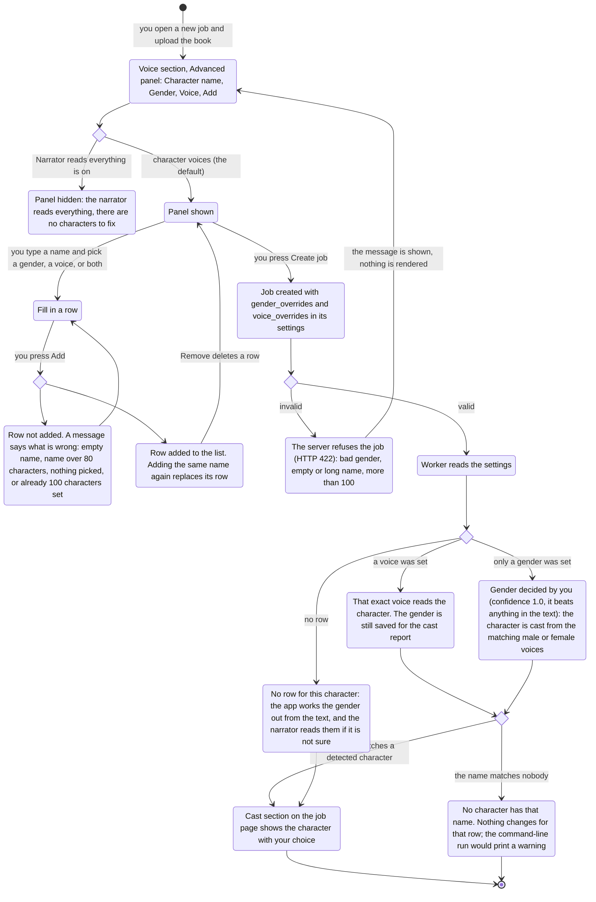

# Fix a character's gender in the wizard

Before: the only way to tell the app that Cassie is a woman was the command-line flag
`--gender Cassie=f`. The website had a per-character voice override but nothing for gender,
so an unclear character was read by the narrator and you could not change that.

Now the voice section of the new-job wizard has **Advanced: fix a character's gender or
voice**. For each character you can set a gender, a voice, or both. This page shows the flow.

## The flow

## What changes for you

- You can tell the app a character's gender before the job starts, on the website.
- A gender row is enough: the character gets a voice of that gender from the pool. Add a
  voice only when you want one specific voice.
- The row list shows each character with the gender and voice you chose, and a Remove button.
- The wizard checks the same limits as the server (name 1 to 80 characters, 100 rows at most),
  so a mistake shows next to the form instead of as a failed job.

## Defaults

- No overrides. The app works the gender out from the text, and when it is not sure the
  narrator voice reads the character.
- The panel is hidden when "Narrator reads everything" is on.

## How to try it

1. New job, upload a book, open the Voice Casting tab.
2. Open **Advanced: fix a character's gender or voice**.
3. Type `Cassie`, pick **Female**, leave the voice on "No preference", press **Add**.
4. Create the job and look at the **Cast** section on the job page.

## Honest limits

- Names are matched as the book spells them. A gender row matches without regard to capital
  letters; a voice row must match exactly.
- You have to know who to fix before the job starts. The review step before rendering (next
  feature) shows the detected cast so you can fix it after the first pass.
